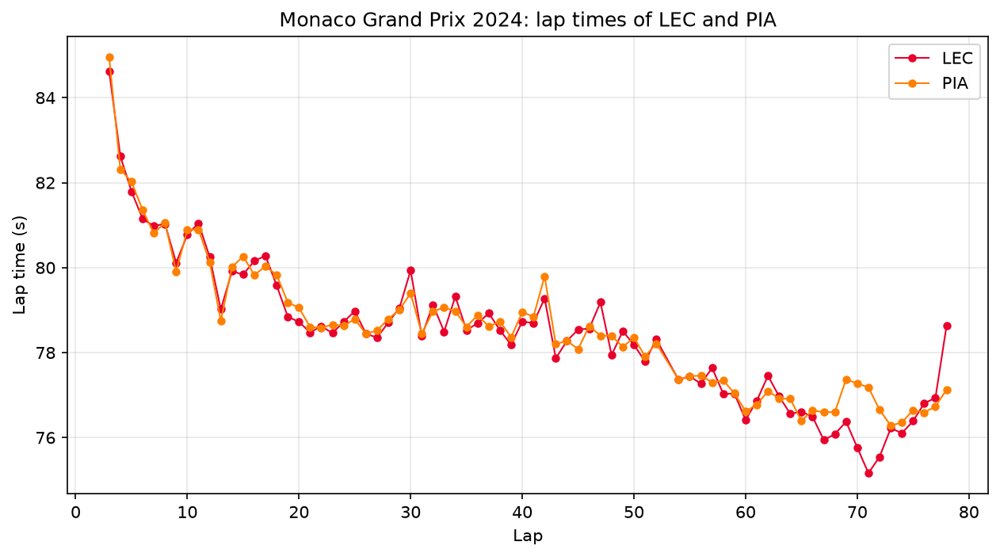
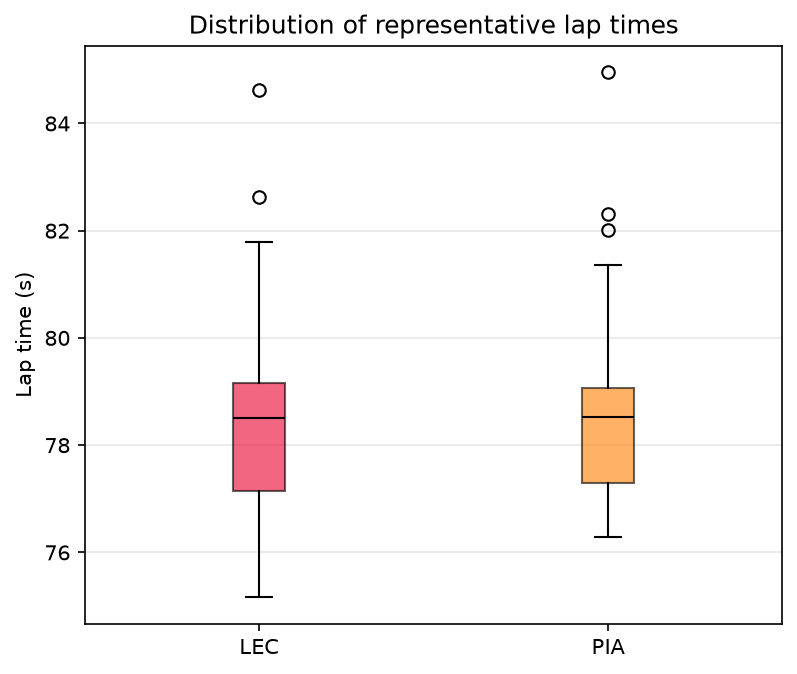
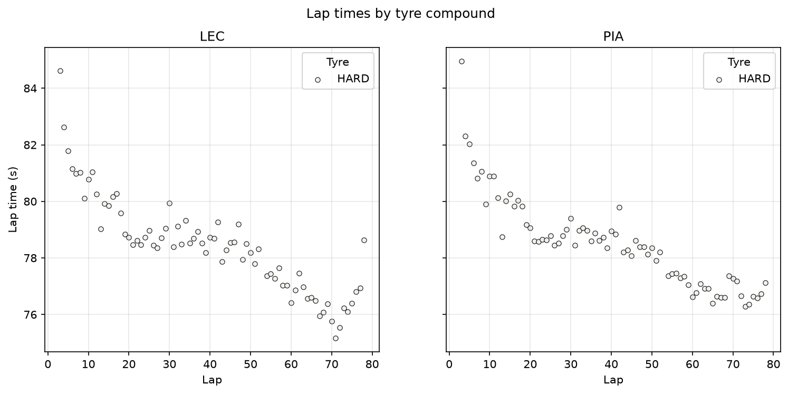
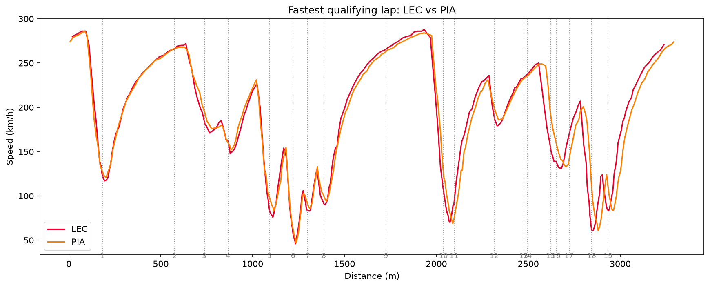
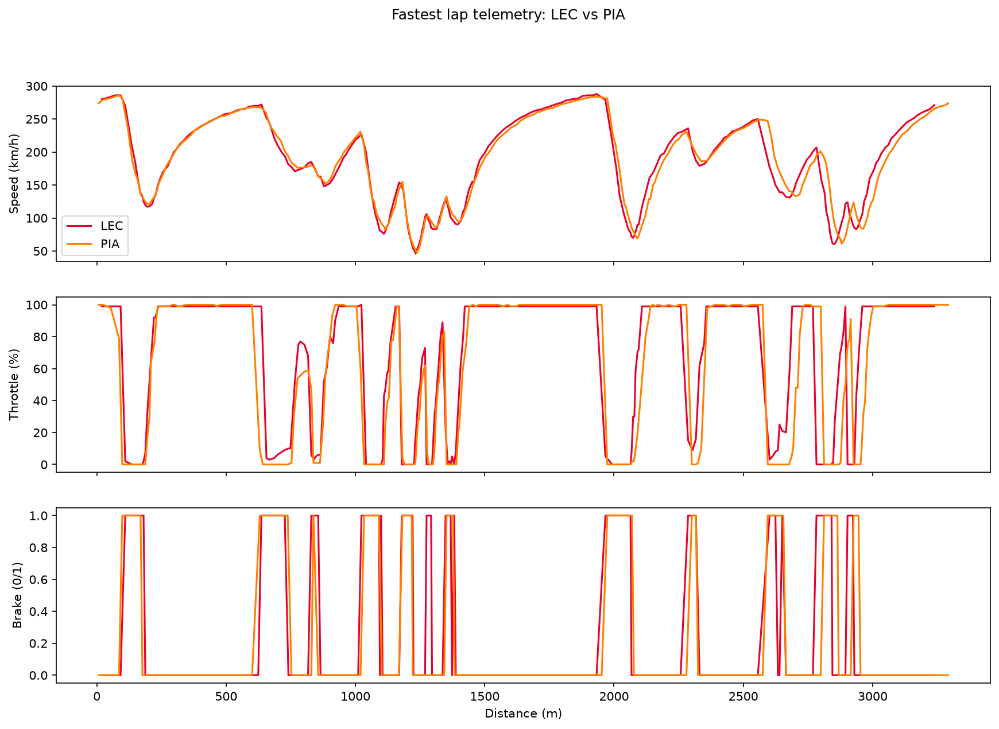

# f1-telemetry-analysis

Formula 1 telemetry analysis with Python and [FastF1](https://docs.fastf1.dev/).

> 🚧 **Work in progress.** The analyses are done; the reusable code in `src/` is still to come.

## Goal

Answer a simple question using official F1 data:

> **Why was one driver faster than another?**

This is also a learning project for data analysis with **pandas**, **numpy** and **matplotlib**.

## Progress

| Step | Notebook | Status |
|---|---|---|
| Setup and FastF1 cache | `01_exploration` | ✅ Done |
| Loading a session | `01_exploration` | ✅ Done |
| Exploring lap data | `01_exploration` | ✅ Done |
| Comparing the race pace of two drivers | `02_driver_comparison` | ✅ Done |
| Charts (lap times, consistency) | `03_charts` | ✅ Done |
| Telemetry: where the difference is made | `04_telemetry` | ✅ Done |
| Extracting reusable functions | `src/` | ⏳ Planned |

## Project structure

```
f1-telemetry-analysis/
├── image/        exported charts (for this README)
├── notebooks/    exploration and analyses, one notebook per step
├── src/          reusable functions (planned)
├── requirements.txt
└── README.md
```

## Installation

```bash
python -m venv .venv
source .venv/bin/activate        # bash / zsh (Linux, macOS)
source .venv/bin/activate.fish   # fish
pip install -r requirements.txt
```

### Formula 1 account

Since FastF1 3.9, lap and telemetry data require signing in to a Formula 1 account.
Without it, only session results are available.
Sign in once, from a terminal, with the virtual environment activated:

```bash
python -m fastf1 auth f1tv --authenticate
```

Check the sign-in status:

```bash
python -m fastf1 auth f1tv --status
```

## Running Jupyter

From the root of the repo:

```bash
jupyter lab
```

The notebooks are in `notebooks/` and are meant to be read in order (01, 02, 03, 04).
The FastF1 cache is stored in `cache/` at the root (ignored by Git).

## Results

Case study: **Charles Leclerc (Ferrari) vs Oscar Piastri (McLaren) at the 2024 Monaco Grand Prix**,
the top two in both qualifying and the race.

### Race pace: almost identical



- Leclerc won, Piastri finished 2nd, 7.2 s behind.
- Over the 75 representative laps (excluding the red-flagged first lap, the safety car restart and a yellow-flag lap),
  the median gap is only **0.017 s per lap**. Compared lap by lap, Leclerc is **0.075 s per lap** faster
  and quicker on 46 laps out of 75.
- Overtaking is nearly impossible in Monaco: both drivers manage their tyres at a slow pace early on,
  and lap times drop steadily as the cars burn fuel.
- Most of the final gap is built between **laps 66 and 72**, when Leclerc speeds up (down to 1:15.2)
  while Piastri stays around 1:17.



Both medians sit at about 78.5 s. Leclerc's box reaches lower because of his fast laps at the end of the race.

### Tyres: one hard stint for the whole race



Both drivers started on mediums but switched to hards during the first-lap red flag, which spared them a pit stop.

### Qualifying telemetry: where pole position was won



| Sector | Leclerc | Piastri | Gap |
|---|---|---|---|
| 1 | 18.386 s | 18.303 s | Piastri +0.083 s |
| 2 | 33.174 s | 33.380 s | **Leclerc +0.206 s** |
| 3 | 18.710 s | 18.741 s | Leclerc +0.031 s |

- Leclerc takes pole by **0.154 s** (1:10.270 vs 1:10.424).
- Piastri is faster in sector 1, but Leclerc makes the difference in **sector 2**.
- Leclerc spends more of the lap at full throttle (about 46 % of samples vs 41 %).



> **Limitation:** distance is computed from speed, so the two laps end about 50 m apart.
> The curves drift slightly towards the end of the lap; official sector times are the more reliable measure.

## License

[MIT](LICENSE)
